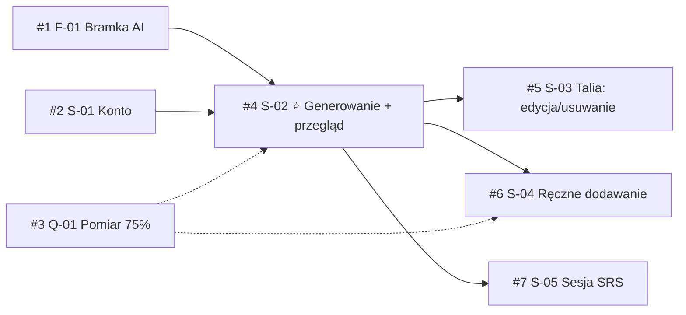

# Task Management — GitHub mirror of roadmap.md

> `context/foundation/roadmap.md` is the **source of truth** for scope, order and dependencies.
> GitHub Issues is the **execution mirror**: one issue per roadmap item, used for tracking work, PRs and status.
> When the two disagree, fix the roadmap first, then sync the issue.

## Overview

| What          | Where                                                                                        |
| ------------- | -------------------------------------------------------------------------------------------- |
| System        | GitHub Issues                                                                                |
| Repository    | [Bondar91/10xCards](https://github.com/Bondar91/10xCards/issues)                             |
| Milestone     | [MVP (roadmap v1)](https://github.com/Bondar91/10xCards/milestone/1) — no due date by design |
| Tooling       | `gh` CLI (account `Bondar91`), native GitHub issue dependencies ("blocked by")               |
| Roadmap links | `Issue` column in roadmap "At a glance" table, `backlog:` key in roadmap front matter        |

## Mapping roadmap → GitHub

| Roadmap element                      | GitHub representation                                                        |
| ------------------------------------ | ---------------------------------------------------------------------------- |
| Foundation / Slice (`F-NN` / `S-NN`) | One issue; title `[<ID>] <title>` taken from the Backlog Handoff table       |
| Foundation vs slice                  | Label `type:foundation` / `type:slice`                                       |
| Status (`ready` / `proposed`)        | Label `status:ready` / `status:proposed`                                     |
| Stream (A / B)                       | Label `stream:A` / `stream:B`                                                |
| North star                           | Label `north-star`                                                           |
| Prerequisites                        | "Blocked by: #N" in issue body **and** native GitHub "blocked by" relation   |
| Parallel with                        | "Parallel with" line in issue body (no relation)                             |
| Unknowns                             | Checkbox list in issue body                                                  |
| Open Roadmap Question                | Separate issue `[Q-NN] …` with label `type:question`                         |
| Change ID                            | Shown in issue header; becomes `context/changes/<change-id>/` via `/10x-new` |
| Parked, Baseline, Vision, North star | **Not mirrored** — live only in roadmap.md                                   |

## Issue index

| #                                                   | Roadmap ID | Change ID                   | Title                                                                   | Labels                                            | Blocked by | Ready for `/10x-plan` |
| --------------------------------------------------- | ---------- | --------------------------- | ----------------------------------------------------------------------- | ------------------------------------------------- | ---------- | --------------------- |
| [#1](https://github.com/Bondar91/10xCards/issues/1) | F-01       | `ai-provider-gateway`       | [F-01] Bramka AI: wywołanie LLM na produkcji bez retencji               | type:foundation, status:ready, stream:A           | —          | yes                   |
| [#2](https://github.com/Bondar91/10xCards/issues/2) | S-01       | `account-access-production` | [S-01] Konto: rejestracja, logowanie, wylogowanie na produkcji          | type:slice, status:ready, stream:B                | —          | yes                   |
| [#3](https://github.com/Bondar91/10xCards/issues/3) | Q-01       | —                           | [Q-01] Jak mierzymy kryteria sukcesu (75% akceptacji, 75% fiszek z AI)? | type:question, stream:A                           | —          | n/a (decision)        |
| [#4](https://github.com/Bondar91/10xCards/issues/4) | S-02       | `ai-generation-review`      | [S-02] Wklej tekst → AI → przegląd → zapis do talii                     | type:slice, status:proposed, stream:A, north-star | #1, #2     | no                    |
| [#5](https://github.com/Bondar91/10xCards/issues/5) | S-03       | `deck-browse-edit-delete`   | [S-03] Talia: przeglądanie, edycja, usuwanie fiszek                     | type:slice, status:proposed, stream:A             | #4         | no                    |
| [#6](https://github.com/Bondar91/10xCards/issues/6) | S-04       | `manual-flashcard-create`   | [S-04] Ręczne dodawanie fiszki                                          | type:slice, status:proposed, stream:A             | #4         | no                    |
| [#7](https://github.com/Bondar91/10xCards/issues/7) | S-05       | `srs-review-session`        | [S-05] Sesja powtórek SRS                                               | type:slice, status:proposed, stream:A             | #4         | no                    |

## Dependency graph



Solid arrow = blocked by (native GitHub relation). Dotted = related (decision should land before `/10x-plan` of #4 and #6).

## Labels

| Label             | Color     | Meaning                                                  |
| ----------------- | --------- | -------------------------------------------------------- |
| `type:foundation` | `#5319e7` | Bounded horizontal enabler unlocking a vertical slice    |
| `type:slice`      | `#1d76db` | Vertical, user-visible roadmap slice                     |
| `type:question`   | `#d876e3` | Open roadmap question needing a decision                 |
| `status:ready`    | `#0e8a16` | Ready for `/10x-plan`                                    |
| `status:proposed` | `#fbca04` | Proposed; waiting on prerequisites                       |
| `stream:A`        | `#c5def5` | Stream A: Generowanie i talia (F-01 → S-02 → S-03/04/05) |
| `stream:B`        | `#bfdadc` | Stream B: Dostęp do konta (S-01)                         |
| `north-star`      | `#ff7f50` | North-star slice of the roadmap (S-02)                   |

GitHub default labels (`bug`, `enhancement`, …) are left untouched.

## Issue body template

```markdown
**Roadmap ID:** S-NN · **Change ID:** `change-id` · **PRD refs:** FR-…, US-…

## Outcome

<copied from roadmap item>

## Dependencies

- Blocked by: #N (ID), …
- Parallel with: …

## Unknowns

- [ ] <question> — Owner: … · Block: yes/no (…)

## Risk

<copied from roadmap item>

---

Ready for `/10x-plan`: **yes/no** · Source: `context/foundation/roadmap.md`
```

Bodies are written in Polish, matching roadmap.md.

## Sync rules

1. **Roadmap first.** Scope, order or dependency changes go into `roadmap.md`, then the matching issue is edited.
2. **Status change** → swap the `status:*` label and update the Status column in roadmap.md.
3. **New roadmap item** → new issue in milestone `MVP (roadmap v1)` with the labels above; add its `#N` to the roadmap `Issue` column; set native "blocked by" relations.
4. **Starting work** → `/10x-new <change-id>` creates `context/changes/<change-id>/`; mention the issue there and use `Closes #N` in the PR.
5. **Finishing work** → `/10x-archive` marks the roadmap item `done`; the issue closes via the PR (or manually).
6. **Q-01 resolved** → record the decision in #3, close it, update "Open Roadmap Questions" in roadmap.md and the scope of #4 / #6 if measurement is in.
7. **Roadmap v2** → new milestone; do not reuse closed issues.

## Useful `gh` commands

```bash
# All roadmap issues
gh issue list -R Bondar91/10xCards --milestone "MVP (roadmap v1)" --state all

# What can be picked up now
gh issue list -R Bondar91/10xCards --label "status:ready"

# Promote an item to ready
gh issue edit 4 -R Bondar91/10xCards --remove-label "status:proposed" --add-label "status:ready"

# Add a native "blocked by" relation (#A blocked by #B)
gh api -X POST repos/Bondar91/10xCards/issues/A/dependencies/blocked_by \
  -F issue_id=$(gh api repos/Bondar91/10xCards/issues/B --jq .id)

# Close with a comment
gh issue close 3 -R Bondar91/10xCards -c "Decision: …"
```

## Other tools

The Linear MCP server (`linear-server`) holds a **secondary mirror** of these issues (project 10xCards, KRY-5..KRY-11) — see `context/foundation/task-linear.md`. GitHub Issues stays canonical for 10xCards; sync Linear after GitHub.
